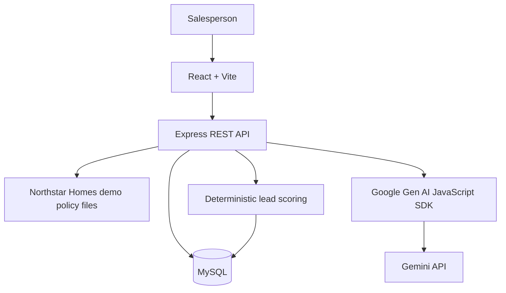

# PropIntel

PropIntel is a small AI-assisted workspace for real-estate salespeople. It helps a salesperson capture customer enquiries, understand each lead, prioritize follow-ups and record the next action.

> Built for the Masal AI – AI FDE Intern (Round 2) assignment. The workspace and company data are fictional demo content.

## What it does

- Captures multiple leads with customer name, location, property requirement, budget, buying timeline and a free-text enquiry.
- Uses a real Gemini API call to produce a lead summary, customer intent, requirements, objections, recommended next action and a suggested customer response.
- Calculates a separate, explainable lead score out of 100 and labels each analysed lead Hot, Warm or Cold.
- Ranks the lead list by the latest saved AI score. Leads without an analysis appear after analysed leads.
- Provides a lead-specific assistant grounded in the selected lead, its latest analysis, saved conversation history and fictional Northstar Homes policies.
- Saves conversation history per lead.
- Includes a Sales Action Workspace for follow-up tasks, due dates, status management and an activity timeline.
- Lets a salesperson copy an AI recommendation into a task draft, review or edit it, and explicitly confirm task creation.

AI output is advisory. PropIntel does not automatically change a lead, create a task or send a customer message.

## Architecture



### Main components

- **Frontend – `client/`:** React pages and components for lead intake, lead list, lead details, AI analysis, lead chat and task management.
- **Backend – `server/`:** Express routes, request validation, business services, Gemini integration, lead scoring and database access.
- **Company context – `server/src/knowledge/company/`:** Fictional company profile, sales policies, communication guidance and escalation rules used by the AI assistant.
- **Database – `database/schema.sql`:** MySQL schema for leads, analyses, conversations, follow-up tasks and lead activities.

### Main data tables

| Table | Purpose |
|---|---|
| `leads` | Customer requirements and lead status |
| `lead_analyses` | Versioned Gemini analysis and deterministic score |
| `conversations` | Saved user and assistant messages per lead |
| `follow_up_tasks` | Salesperson-confirmed tasks and due dates |
| `lead_activities` | Lead, analysis and task activity history |

### AI request flow

1. The backend loads the selected lead and fictional company context.
2. It sends the prompt to Gemini using the official `@google/genai` SDK and the configured `GEMINI_MODEL`.
3. Gemini is asked to return structured JSON for the six requested analysis fields.
4. The backend parses and validates the response before returning or storing it.
5. The backend calculates the score independently; Gemini does not choose the numeric score or priority band.
6. For chat, the backend also loads the latest analysis and up to 12 recent messages belonging to that lead. Full conversation history remains in MySQL.

The Gemini API key is used only by the backend. It must never be placed in a `VITE_*` variable or committed to Git.

## Technology

- React 19 and Vite
- Node.js and Express 5
- MySQL 8+
- Google Gen AI JavaScript SDK (`@google/genai`) and Gemini
- Node.js built-in test runner and GitHub Actions

## Run locally (Windows PowerShell)

### Prerequisites

- Node.js 20.19 or newer
- npm (included with Node.js)
- MySQL 8+
- A Gemini API key from Google AI Studio

### 1. Clone and install

```powershell
git clone https://github.com/keerthivasan91/PropIntel.git
cd PropIntel
npm install
```

The root `package.json` defines npm workspaces for `client` and `server`. Run installation commands from the repository root.

### 2. Configure the backend

```powershell
Copy-Item .\server\.env.example .\server\.env
```

Open `server/.env` and set the values for your local environment:

| Variable | Purpose |
|---|---|
| `NODE_ENV` | Runtime mode; use `development` locally |
| `PORT` | Express API port; default `5000` |
| `CLIENT_ORIGINS` | Comma-separated allowed frontend origins; default local Vite origin |
| `MYSQL_HOST` | MySQL host |
| `MYSQL_PORT` | MySQL port; default `3306` |
| `MYSQL_USER` | MySQL username |
| `MYSQL_PASSWORD` | MySQL password |
| `MYSQL_DATABASE` | Database name; use `propintel` |
| `MYSQL_CONNECTION_LIMIT` | MySQL connection-pool size |
| `GEMINI_API_KEY` | Gemini API key; backend only |
| `GEMINI_MODEL` | Gemini model ID; default `gemini-3.5-flash-lite` |

The checked-in example uses `gemini-3.5-flash-lite`, which was tested during development. Use a model enabled for the API key you configure.

### 3. Create the database

Run from the repository root:

```powershell
Get-Content .\database\schema.sql | mysql -u root -p
```

Optional: load fictional sample leads once:

```powershell
Get-Content .\database\seed.sql | mysql -u root -p propintel
```

The schema creates the five tables listed above. No additional migration is required for the AI-recommendation-to-task workflow.

### 4. Start frontend and backend

```powershell
npm run dev
```

- Frontend: http://localhost:5173
- API health: http://localhost:5000/api/health
- Database readiness: http://localhost:5000/api/health/ready

### Useful commands

```powershell
npm test
npm run build
```

- `npm test` runs the backend's Node.js tests.
- `npm run build` creates the production frontend bundle in `client/dist`.

## Lead prioritization

The backend score is a deterministic heuristic with a maximum of 100 points:

| Signal | Maximum |
|---|---:|
| Buying timeline | 30 |
| Budget clarity | 25 |
| Requirement clarity | 25 |
| Engagement signals | 20 |
| **Total** | **100** |

Priority bands are Hot (75–100), Warm (45–74) and Cold (0–44). The lead list uses the latest saved analysis for each lead, sorts by score descending and shows unanalysed leads last. The score is an internal sorting aid, not a purchase probability or sales forecast.

See [docs/lead-scoring.md](docs/lead-scoring.md) for the actual rules and limitations.

## Human-reviewed AI recommendation

The AI analysis includes a recommended next action. In the lead details, the salesperson can select **Use AI recommendation** to copy that text into the existing task form. The salesperson can edit the title and description, choose a due date, and then select **Create task**.

The existing task endpoint saves the confirmed task and records an activity event. This is a human-reviewed handoff, not an autonomous agent. It does not add a database table or automatically communicate with the customer.

## API overview

### Leads

- `GET /api/leads` – list, search and filter leads; returns latest AI priority and score, sorted by priority
- `POST /api/leads` – create a lead
- `GET /api/leads/summary` – summary counts by lead status
- `GET /api/leads/:id` – get lead details
- `PATCH /api/leads/:id` – update lead fields or status

### AI

- `POST /api/leads/:id/analyze` – generate and save a structured analysis
- `GET /api/leads/:id/analyses` – retrieve analysis history
- `POST /api/leads/:id/chat` – send a contextual assistant message
- `GET /api/leads/:id/conversations` – retrieve saved messages

### Sales actions

- `POST /api/leads/:id/tasks` – create a salesperson-confirmed task
- `GET /api/leads/:id/tasks` – list tasks for a lead
- `GET /api/leads/:id/activities` – retrieve the lead activity timeline
- `GET /api/tasks` – search and filter tasks
- `GET /api/tasks/summary` – task summary counts
- `PATCH /api/tasks/:id` – update task details or status

See [docs/api-contract.md](docs/api-contract.md) for request fields, filters and response details.

## Key technical decisions

- **Database persistence:** MySQL stores leads, analysis versions, conversations, tasks and activity events so the application survives restarts.
- **Backend-owned AI calls:** the API key is not exposed to the browser.
- **Structured AI output:** Gemini is asked for JSON and the backend validates it again before storing it.
- **Explainable priority:** numeric scoring is calculated using explicit backend rules rather than trusting an LLM-generated score.
- **Lead-scoped context:** chat history is loaded by lead ID, and only the most recent 12 messages are sent with each model request to bound prompt size.
- **Human approval:** AI recommendations prefill a draft; a salesperson must review and create the task.
- **Transactional activity history:** task creation and status changes save the task and its activity event in the same database transaction.

## Security and demo data

- Use synthetic data only. Do not enter actual customer details, personal information or confidential business information.
- Northstar Homes and its company policies are fictional demo content. They are not Masal AI policies.
- Keep `server/.env` private and never commit API keys or database credentials.
- The browser does not receive the Gemini API key.
- AI responses can be inaccurate. Verify property facts, prices, availability and all customer-facing text before use.

## Known limitations

- The demo does not connect to a live property inventory, CRM, calendar, WhatsApp or calling system. It cannot confirm actual property availability or book site visits.
- It is a text-based sales workflow; speech-to-text, text-to-speech and voice calling are outside this assignment's scope.
- There is no user authentication or multi-tenant access control. Use synthetic data only and do not treat the public demo as a production CRM.
- Lead scoring is a transparent heuristic, not a trained conversion model. Keyword signals can miss context or negation.
- Gemini may return inaccurate content even when its response matches the required JSON schema.
- Chat uses a bounded 12-message context window; full history is stored, but older turns are not included in each model request.
- The demo company policy pack is fictional and limited to the included example documents.
- Gemini usage is subject to API availability, rate limits and quota.

## Troubleshooting

- **API unavailable:** confirm the backend is running and open http://localhost:5000/api/health.
- **Database not ready:** verify MySQL is running and that the MYSQL_* values in `server/.env` match the database you created.
- **CORS error:** add the exact frontend origin to `CLIENT_ORIGINS`, then restart the backend.
- **AI not configured:** confirm `GEMINI_API_KEY` is set in `server/.env`; never add it to the frontend environment.
- **Model or quota error:** check that `GEMINI_MODEL` is available to the configured API key and that the Google AI Studio project has available quota.

## Manual acceptance and demo

- [docs/manual-test-plan.md](docs/manual-test-plan.md) – end-to-end checks to run before submission.
- [docs/demo-script.md](docs/demo-script.md) – suggested three-minute walkthrough.

## AI usage disclosure

ChatGPT (OpenAI) was used to help clarify the assignment scope, plan the implementation, generate and review code changes, debug issues, and prepare project documentation and test/demo checklists. The developer is responsible for reviewing the final code, running the checks, and understanding the implementation. Add any other AI tools actually used during development before submission; do not list tools that were not used.

## License

No license has been added. The repository is an assignment submission.
