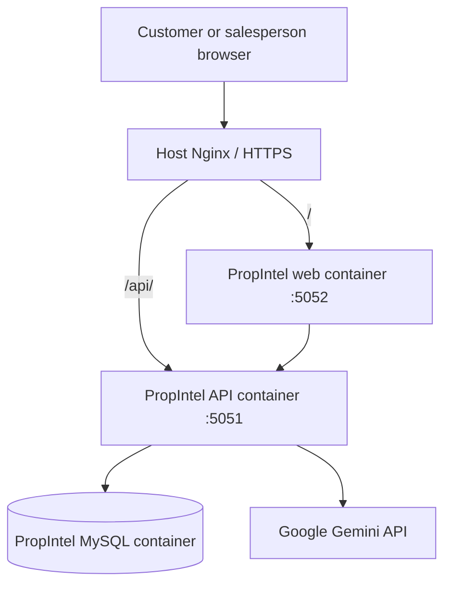

# PropIntel — AI-assisted real-estate lead intelligence

PropIntel helps a real-estate salesperson capture customer enquiries, understand each lead, prioritize follow-ups, and manage the next action from one workspace.

> Built for the **Masal AI — AI FDE Intern (Round 2)** assignment. Northstar Homes, its policies, and the sample leads are fictional demonstration data.

## Demo

| | |
|---|---|
| **Customer enquiry page** | [https://propintel.iamkeerthivasan.in](https://propintel.iamkeerthivasan.in) |
| **Salesperson workspace** | [https://propintel.iamkeerthivasan.in/admin](https://propintel.iamkeerthivasan.in/admin) |
| **Admin username** | `admin` |
| **Demo password** | `PropIntel2026` |
| **Source code** | [github.com/keerthivasan91/PropIntel](https://github.com/keerthivasan91/PropIntel) |

The demo login is intentionally shared for assignment evaluation. It is for this synthetic-data demo only; do not reuse it for real customer information or a production business. Rotate it after evaluation. The public enquiry page can submit a lead; customer records and the internal workspace require admin authentication.

## What it does

- **Public lead intake:** captures name, location, property requirement, budget range, buying timeline, and the customer's message.
- **Protected salesperson workspace:** single-admin login, lead overview, lead list, search and filters, and lead detail tabs.
- **Gemini lead analysis:** generates a summary, customer intent, key requirements, objections or concerns, recommended next action, and suggested customer response.
- **Lead prioritization:** calculates a separate explainable score out of 100 and assigns Hot, Warm, or Cold priority. Analysed leads are ranked by their latest saved score.
- **Lead-specific AI Assistant:** answers salesperson questions using the selected lead, its latest analysis, saved conversation history, and the fictional company policy documents.
- **Sales Action Workspace:** creates and tracks follow-up tasks, due dates, status, and lead activity.
- **Human-reviewed AI handoff:** copies an AI recommendation into a task draft. A salesperson reviews and confirms before the task is saved.

AI output is advisory. PropIntel does not automatically change a lead, create a task, or send a customer message.

## Product walkthrough

1. A customer submits a property enquiry on the public page.
2. The salesperson signs in at `/admin` and opens the new lead.
3. The salesperson requests a Gemini analysis and reviews the six structured fields.
4. The salesperson asks the lead-specific assistant a follow-up question.
5. The salesperson uses the AI recommendation as a draft, edits it, and explicitly creates a follow-up task.

See [docs/demo-script.md](docs/demo-script.md) for a timed walkthrough of up to three minutes.

## Architecture

### Application components

- **Frontend — `client/`:** React 19 and Vite. Includes the public enquiry page, admin login, lead workspace, AI assistant, and task workspace.
- **Backend — `server/`:** Node.js and Express 5. Handles validation, authentication, lead operations, Gemini requests, scoring, tasks, and persistence.
- **Database — `database/`:** MySQL schema and fictional sample data.
- **Company context — `server/src/knowledge/company/`:** fictional company profile, sales policies, communication guidance, and escalation rules.

### Azure deployment topology

The deployed Compose project is named `propintel`. It has its own API, frontend, MySQL service, network, and persistent MySQL volume.



- Host Nginx routes the website to `127.0.0.1:5052` and `/api/` requests to `127.0.0.1:5051`.
- The API and frontend ports are published on host loopback only. MySQL is not published to the host.
- The database uses a dedicated Compose volume, `propintel_mysql_data`.
- Compose resource limits are set for the database, API, and frontend to reduce impact on other workloads on the VM.
- The Azure VM also hosts SpectraSpatialAI as a separate Compose project. PropIntel uses a separate Compose project and does not share its containers, database volume, or application credentials.

See [docs/architecture.md](docs/architecture.md) and [docs/deployment.md](docs/deployment.md).

## AI implementation

PropIntel uses the official Google Gen AI JavaScript SDK (`@google/genai`) to call Gemini from the backend. The model is configured using `GEMINI_MODEL` (demo default: `gemini-3.5-flash-lite`).

### Lead analysis

1. Load the selected lead and the fictional Northstar Homes context.
2. Send the lead details and approved context to Gemini.
3. Request structured JSON containing the six analysis fields.
4. Parse and validate the response on the backend.
5. Calculate the priority score independently using deterministic rules.
6. Save the analysis version, score, and activity in MySQL.

### Contextual assistant

Each chat request is grounded in the selected lead, its latest analysis, the fictional policy documents, and up to 12 recent messages for that lead. Conversation messages are persisted per lead in MySQL. The assistant is restricted to the real-estate sales-support use case and can return decisions such as allowed, out of scope, needs policy clarification, or escalate.

The model cannot set the numeric lead score, change lead status, create tasks, or send messages to customers. A salesperson remains responsible for every action.

More detail: [docs/ai-design.md](docs/ai-design.md).

## Lead scoring

The score is a deterministic backend heuristic, not an LLM-generated value or a prediction of purchase probability.

| Signal | Maximum points |
|---|---:|
| Buying timeline | 30 |
| Budget clarity | 25 |
| Requirement clarity | 25 |
| Engagement signals | 20 |
| **Total** | **100** |

Priority bands:
- **Hot:** 75–100
- **Warm:** 45–74
- **Cold:** 0–44

The lead list uses the latest saved analysis, sorts by score descending, and places unanalysed leads last. See [docs/lead-scoring.md](docs/lead-scoring.md).

## Technology

- React 19, Vite 8
- Node.js 22 container, Express 5
- MySQL 8
- Google Gen AI JavaScript SDK and Gemini
- Docker Compose
- Nginx and Certbot for the public hostname
- Node.js built-in test runner and GitHub Actions

## Run locally

### Prerequisites

- Node.js 20.19 or newer
- npm
- MySQL 8+
- Gemini API key from Google AI Studio

### 1. Clone and install

```bash
git clone https://github.com/keerthivasan91/PropIntel.git
cd PropIntel
npm install
```

### 2. Configure the backend

Copy the example file:

```bash
cp server/.env.example server/.env
```

Set these values in `server/.env` for local development:

| Variable | Local value / purpose |
|---|---|
| `NODE_ENV` | `development` |
| `PORT` | `5000` |
| `CLIENT_ORIGINS` | `http://localhost:5173` |
| `MYSQL_HOST` | `127.0.0.1` |
| `MYSQL_PORT` | `3306` |
| `MYSQL_USER`, `MYSQL_PASSWORD` | Your local MySQL account |
| `MYSQL_DATABASE` | `propintel` |
| `GEMINI_API_KEY` | Your Gemini API key |
| `GEMINI_MODEL` | `gemini-3.5-flash-lite` |
| `ADMIN_USERNAME` | `admin` |
| `ADMIN_PASSWORD` | A non-empty local-only password |
| `SESSION_SECRET` | Random secret with at least 32 characters |

Never commit the real `server/.env` file. The Gemini key is backend-only and must not be put in a `VITE_*` variable.

### 3. Create the database and optional sample data

```bash
mysql -u root -p < database/schema.sql
mysql -u root -p propintel < database/seed.sql
```

The seed file inserts three fictional leads: Aarav Mehta, Nisha Rao, and Kabir Sharma. Run it only once on a fresh demo database.

### 4. Run and test

```bash
npm run dev
```

- Public enquiry page: [http://localhost:5173](http://localhost:5173)
- Admin workspace: [http://localhost:5173/admin](http://localhost:5173/admin)
- API health: [http://localhost:5000/api/health](http://localhost:5000/api/health)
- Database readiness: [http://localhost:5000/api/health/ready](http://localhost:5000/api/health/ready)

In a separate terminal:

```bash
npm test
npm run build
```

## Docker deployment

The repository includes a separate Docker Compose stack.

1. Create a root `.env` containing `MYSQL_PASSWORD` and `MYSQL_ROOT_PASSWORD`.
2. Create `server/.env` with production values. Set `MYSQL_HOST=db`, `MYSQL_USER=propintel_app`, and `MYSQL_PASSWORD` to the same application database password in the root `.env`. Configure `GEMINI_API_KEY`, `SESSION_SECRET`, and admin credentials there.
3. Start the stack:

```bash
docker compose config --quiet
docker compose up -d --build
docker compose ps
```

The Compose file initializes the schema when the MySQL data volume is first created. To load the fictional sample leads after the database is healthy, run:

```bash
docker compose exec -T db sh -c 'mysql -u"$MYSQL_USER" -p"$MYSQL_PASSWORD" "$MYSQL_DATABASE"' < database/seed.sql
```

Useful operational commands:

```bash
docker compose logs --tail=100 api
docker compose logs --tail=100 web
docker compose logs --tail=100 db
curl http://127.0.0.1:5051/api/health
curl http://127.0.0.1:5051/api/health/ready
```

For the Azure Nginx and HTTPS configuration, see [docs/deployment.md](docs/deployment.md).

## API overview

All endpoints use the `/api` base path.

| Area | Endpoint | Purpose |
|---|---|---|
| Public intake | `POST /api/public/enquiries` | Submit a customer enquiry |
| Authentication | `GET /api/auth/me` | Check admin session |
| Authentication | `POST /api/auth/login` | Sign in |
| Authentication | `POST /api/auth/logout` | Sign out |
| Leads | `GET /api/leads` | List and filter leads |
| Leads | `POST /api/leads` | Create lead from admin |
| Leads | `GET /api/leads/:id` | Retrieve a lead |
| Leads | `PATCH /api/leads/:id` | Update lead |
| AI | `POST /api/leads/:id/analyze` | Generate lead analysis |
| AI | `POST /api/leads/:id/chat` | Ask lead-specific assistant |
| AI | `GET /api/leads/:id/analyses` | Get analysis history |
| AI | `GET /api/leads/:id/conversations` | Get saved conversation |
| Tasks | `POST /api/leads/:id/tasks` | Create a reviewed follow-up |
| Tasks | `GET /api/tasks` | Filter follow-up tasks |
| Tasks | `PATCH /api/tasks/:id` | Update task |
| Activity | `GET /api/leads/:id/activities` | View lead activity |

Lead, analysis, conversation, and task endpoints require a valid admin session. See [docs/api-contract.md](docs/api-contract.md) for request and response details.

## Security, privacy, and limitations

- The public form can create an enquiry but cannot list, read, search, or update customer records.
- Internal API routes require a signed, HttpOnly, SameSite=Strict admin session. Sessions expire after eight hours and login attempts are rate-limited.
- Public intake has its own rate limit and accepts only customer enquiry fields; the backend sets the initial status.
- Use synthetic data only. Do not enter real customer details, personal information, or confidential business information.
- Northstar Homes and its policy pack are fictional demo content and are not Masal AI policies.
- AI-generated summaries, recommendations, and messages can be inaccurate. Verify facts and all customer-facing text.
- The demo does not integrate with live property inventory, a CRM, calendar, WhatsApp, or calling system. It cannot confirm property availability or book site visits.
- Authentication is single-admin only; there are no staff roles, account recovery, or multi-tenant accounts.
- The lead score is a transparent heuristic, not a trained conversion model.

## Testing

- Backend: `npm test`
- Frontend production build: `npm run build`
- CI: [GitHub Actions](https://github.com/keerthivasan91/PropIntel/actions)

The backend test suite contains 47 tests. The latest repository CI run completed successfully: [view latest workflow](https://github.com/keerthivasan91/PropIntel/actions).

For end-to-end checks, see [docs/manual-test-plan.md](docs/manual-test-plan.md).

## AI usage disclosure

ChatGPT (OpenAI) was used as a helping hand to accelerate MVP development. It assisted with planning, generating and refining code, debugging, and preparing documentation. I reviewed and tested the implementation and am responsible for the final code and product decisions.

## Repository structure

```text
PropIntel/
├── client/                  # React + Vite frontend
├── server/                  # Express API and Gemini integration
├── database/
│   ├── schema.sql           # MySQL tables
│   └── seed.sql             # Fictional sample leads
├── docs/                    # Architecture, AI, API, testing and demo docs
├── docker-compose.yml       # Isolated production Compose stack
└── README.md
```

## License

No license has been added. This repository is an assignment submission.
