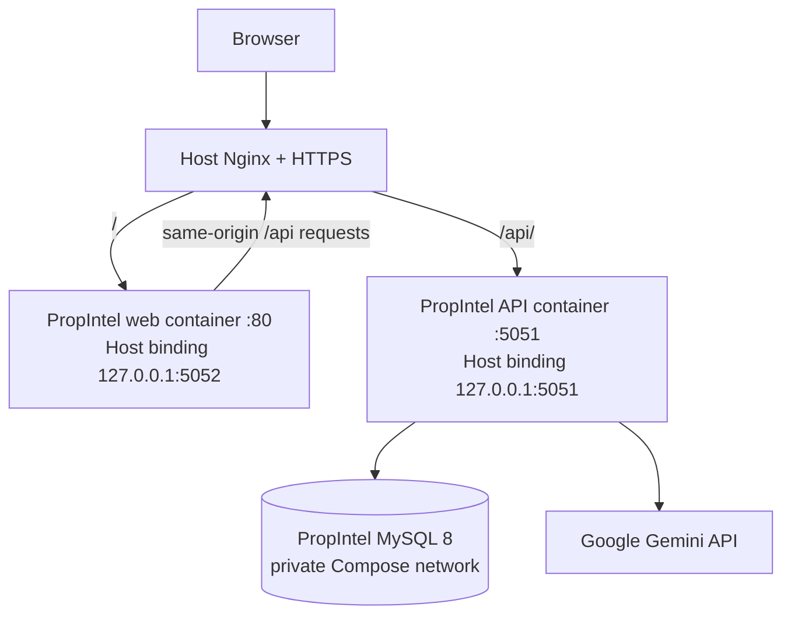

# PropIntel architecture

## Product shape

PropIntel is a modular monolith with two application runtimes:

- **React/Vite frontend** — public property enquiry page and authenticated salesperson workspace.
- **Express API** — public intake, admin authentication, lead management, Gemini integration, scoring, conversations, tasks, and activities.
- **MySQL** — persistent storage for leads, analysis versions, conversations, follow-up tasks, and activity history.

The application is designed for the Masal AI AI FDE Intern Round 2 assignment. Northstar Homes and all policy documents/sample leads are fictional demo data.

## Deployed Azure topology

The production Compose project is named `propintel` and is separate from the existing SpectraSpatialAI Compose project.

The host Nginx virtual host for `propintel.iamkeerthivasan.in` routes website traffic to `127.0.0.1:5052` and `/api/` traffic to `127.0.0.1:5051`. TLS is terminated at host Nginx using Certbot.

The Compose file publishes frontend and backend ports on host loopback only. MySQL has no host-published port. The database persists in the dedicated `propintel_mysql_data` volume.

## Runtime components

### Frontend — `client/`

- React 19 and Vite.
- Public property enquiry form and submission confirmation.
- Admin sign-in and protected lead workspace.
- Lead overview, AI analysis history, contextual assistant, follow-up tasks, and activity timeline.
- The API client uses same-origin `/api` paths in production.

### Backend — `server/`

- Node.js and Express 5.
- Input validation and public-enquiry rate limiting.
- Signed admin sessions and protected internal API routes.
- Gemini structured lead analysis and lead-specific conversation.
- Deterministic lead scoring.
- MySQL persistence and transactional task/activity updates.

### Database — `database/`

Five tables:

| Table | Purpose |
|---|---|
| `leads` | Customer requirement and lead status |
| `lead_analyses` | Versioned Gemini analysis, score, priority, and breakdown |
| `conversations` | User and assistant messages scoped to a lead |
| `follow_up_tasks` | Salesperson-confirmed follow-up work |
| `lead_activities` | Lead, analysis, and task activity timeline |

## Request flows

### Public enquiry

1. Customer submits the public React form.
2. The frontend sends `POST /api/public/enquiries`.
3. The backend validates only the allowed customer fields and ignores caller-supplied admin/status fields.
4. The server creates the lead with status `new` and returns a reference number.
5. Public endpoints do not expose lead listing or retrieval.

### Admin session and lead workspace

1. The administrator signs in using the configured single account.
2. The backend verifies credentials and issues a signed eight-hour HttpOnly, SameSite=Strict cookie; Secure is enabled in production.
3. Lead, analysis, chat, and task endpoints require a valid admin session.
4. Logout clears the cookie.

### AI analysis

1. Backend loads the selected lead and fictional Northstar Homes company context.
2. The backend calls Gemini using the official `@google/genai` SDK.
3. Gemini returns the six structured analysis fields.
4. The backend validates the response and saves a new analysis version.
5. The backend computes the score independently from the LLM response and records an activity entry.

### Lead-specific assistant

Each request uses the selected lead, its latest analysis, the four fictional company-context documents, and up to 12 recent conversation messages for that lead. The saved history remains in MySQL. The backend applies deterministic guards and validates the structured assistant response before persisting both messages in a transaction.

### Human-reviewed task handoff

The salesperson may copy the recommended action into a task draft, edit it, set a due date, and explicitly create it. Task creation and its activity event are stored in one transaction. AI does not create tasks or contact customers autonomously.

## Lead priority

The deterministic score has a maximum of 100 points:

- Buying timeline: 30
- Budget clarity: 25
- Requirement clarity: 25
- Engagement signals: 20

Bands are Hot (75–100), Warm (45–74), and Cold (0–44). The score is an internal prioritization heuristic, not a purchase probability or sales forecast.

## Operational isolation

- Compose project: `propintel`.
- Independent services: `db`, `api`, `web`.
- Independent MySQL volume: `propintel_mysql_data`.
- Host loopback bindings: API `127.0.0.1:5051`, frontend `127.0.0.1:5052`.
- Host Nginx is the public entry point.
- Resource limits are defined per container to constrain use on the shared Azure VM.
- SpectraSpatialAI is a separate Compose project with its own containers, volumes, and configuration.

## Health endpoints

- `GET /api/health` — API process health.
- `GET /api/health/ready` — readiness check including MySQL connectivity.

## Security and data boundaries

- Gemini API key and database/admin secrets remain in backend environment files and are not included in the frontend image.
- The API port and frontend container are bound to host loopback; MySQL is private to the Compose network.
- Public intake and authenticated internal API routes are separated.
- Demo data is fictional. Do not use real customer information.
- The AI API key is never exposed through a `VITE_*` variable.

## Scope limitations

- No integration with live property inventory, CRM, calendars, WhatsApp, or calling.
- No site-visit booking or property-availability verification.
- Single administrator only; no staff roles, password reset, or multi-tenant accounts.
- The score is a transparent heuristic, not a trained conversion model.
- Gemini can still generate inaccurate content despite schema and semantic validation.
